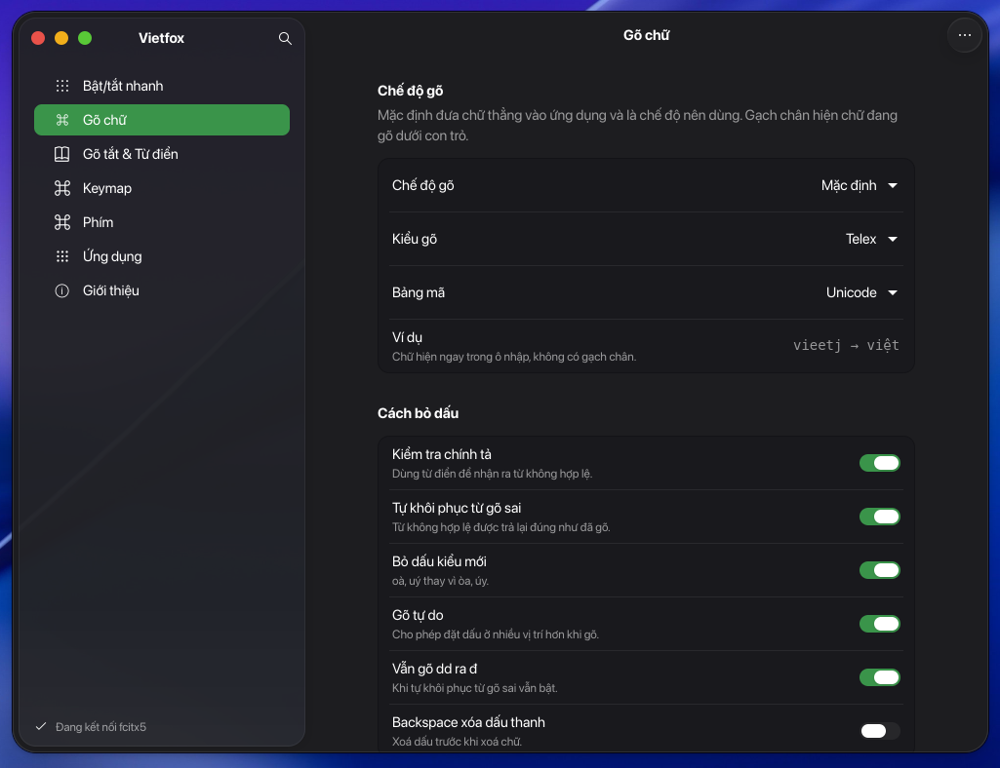
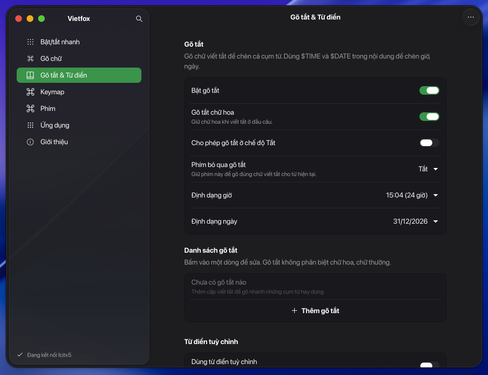
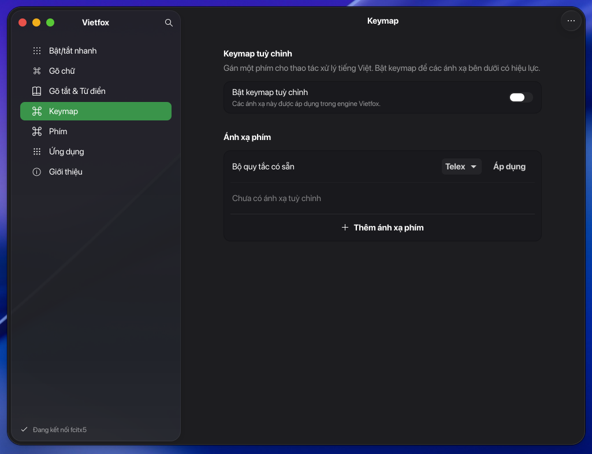
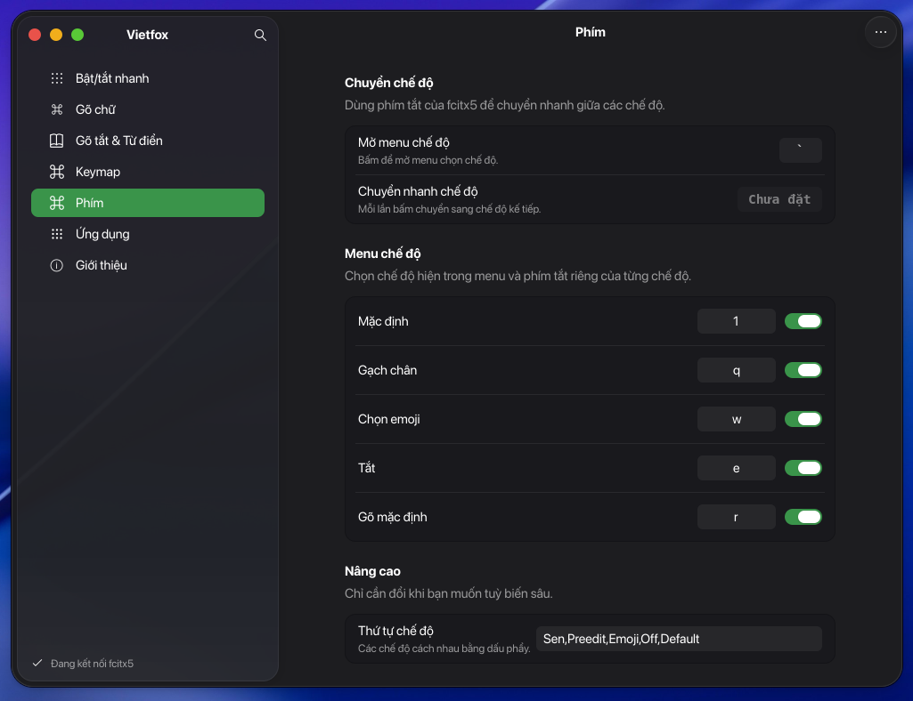
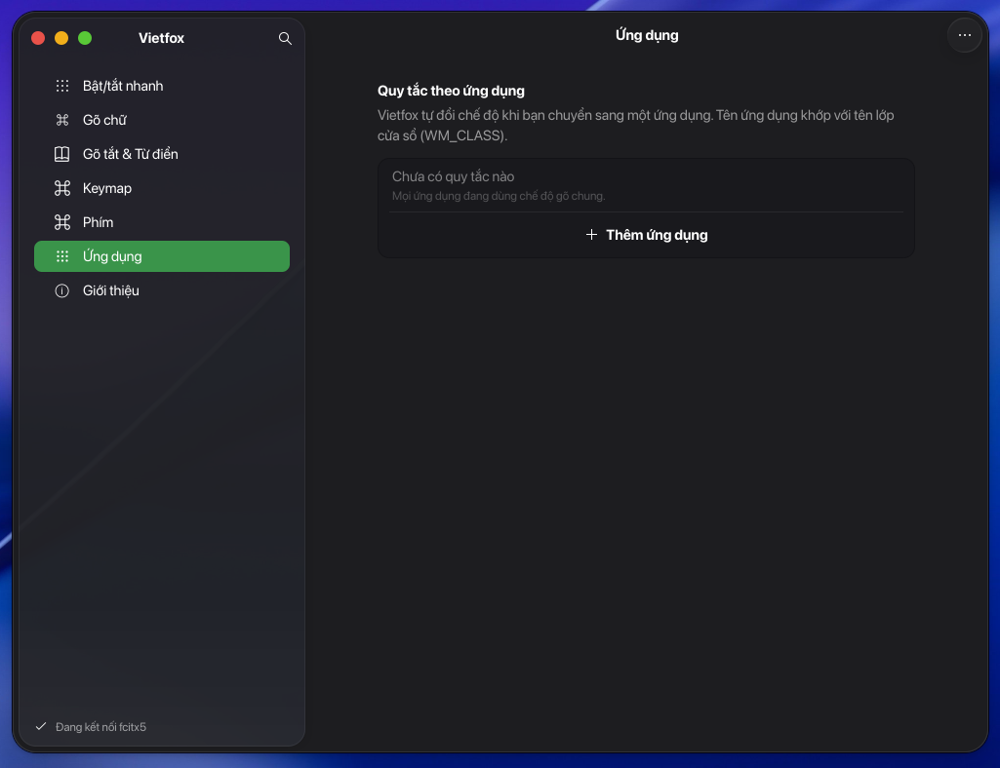

# Vietfox

Bộ gõ tiếng Việt cho Linux, giao diện viết lại hoàn toàn bằng **GTK 4 + libadwaita** — đúng kiểu cửa sổ
Settings của GNOME/Ubuntu: sidebar, nhóm cài đặt, công tắc, tìm kiếm, sáng/tối theo hệ thống.

Vietfox là ứng dụng riêng gồm giao diện GTK 4 và addon Fcitx5 tên `vietfox`. Engine được dựng từ
mã nguồn lõi Ngó Sen; giao diện Settings upstream không được đóng gói. Vietfox giữ lại đường dẫn
cấu hình cũ để dùng tiếp kiểu gõ, từ điển, gõ tắt và quy tắc ứng dụng đã có.

| Gõ chữ | Gõ tắt & Từ điển |
| --- | --- |
|  |  |

| Keymap | Phím |
| --- | --- |
|  |  |

| Ứng dụng | |
| --- | --- |
|  | |

## Có gì trong cửa sổ

| Trang | Nội dung |
| --- | --- |
| **Gõ chữ** | Chế độ gõ, kiểu gõ, bảng mã, cách bỏ dấu, gõ nhanh, tuỳ chọn xử lý surrounding text |
| **Gõ tắt & Từ điển** | Bật gõ tắt, chữ hoa, định dạng `$TIME`/`$DATE`, danh sách gõ tắt, từ điển riêng |
| **Phím** | Phím mở menu chế độ, phím chuyển nhanh, phím tắt và hiển thị từng chế độ, màu biểu tượng |
| **Ứng dụng** | Quy tắc chế độ gõ riêng cho từng app (Zalo, Telegram, VS Code…) |
| **Giới thiệu** | Phiên bản, giấy phép, ghi công |

- Sửa là lưu ngay; không có nút OK/Apply. Mỗi lần lưu có toast kèm **Hoàn tác**.
- Tìm cài đặt bằng Ctrl+F hoặc nút kính lúp; tìm không dấu (`dau` khớp `dấu`).
- Menu chính: sao lưu/khôi phục cấu hình ra JSON, đặt lại về mặc định.
- Sáng/tối, cỡ chữ và màu nhấn theo hệ thống (libadwaita).
- Kết nối fcitx5 qua D-Bus (`org.fcitx.Fcitx.Controller1`); không có fcitx5 thì lưu tạm và báo rõ.

## Chạy thử

Cần Python 3.10+, PyGObject, GTK 4.14+ và libadwaita 1.6+ (Ubuntu 24.10 trở lên, Fedora 41+):

```
sudo apt install python3-gi gir1.2-gtk-4.0 gir1.2-adw-1    # Ubuntu / Debian
sudo dnf install python3-gobject gtk4 libadwaita           # Fedora
sudo pacman -S python-gobject gtk4 libadwaita              # Arch
```

Từ thư mục này:

```
./run.sh
```

hoặc `python3 -m vietfox`.

## Cài đặt

### Cài nhanh trên Ubuntu 26.04 amd64

Chạy một lệnh trong Terminal:

```sh
curl -fsSL https://raw.githubusercontent.com/adfoxtheme/vietfox/main/install.sh | bash
```

Trình cài tải mã nguồn Vietfox và tự cài các gói cần thiết: Fcitx5, `im-config`, frontend GTK 3/4
và Qt 5/6, GTK 4, cùng libadwaita. Sau đó nó cài engine, chọn Fcitx5 làm phương thức nhập, cấu hình
môi trường và tự khởi chạy Fcitx5 trong GNOME, rồi thêm Vietfox vào cấu hình Fcitx5. Trên GNOME
50.0–50.3, trình cài cũng cài và đăng ký extension sửa lỗi Chrome để GNOME nạp ở lần đăng nhập
tiếp theo. Đăng xuất rồi đăng nhập lại sau khi cài để áp dụng các thay đổi phiên làm việc.

Engine đóng gói hiện chỉ có cho Ubuntu 26.04 amd64; trình cài sẽ dừng trên nền khác thay vì cài
nhầm binary. Cần kết nối Internet và mật khẩu quản trị để cài các gói Ubuntu.

Nếu đã tải mã nguồn hoặc gói `.tar.gz` từ [Releases](https://github.com/adfoxtheme/vietfox/releases),
chạy `./install.sh --with-engine` bên trong thư mục đó.

Mục **Cài đặt Vietfox** trên top bar mở launcher Vietfox.

Trên Ubuntu với GNOME 50.0–50.3, Vietfox đăng ký extension tương thích bàn phím trong danh sách
extension được bật của GNOME. Đăng xuất rồi đăng nhập lại để GNOME nạp extension. Không cần bật
thủ công; nếu GNOME chưa nạp extension, xem phần xử lý lỗi Chrome bên dưới.

- Source engine Vietfox nằm trong `engine/source/`; ghi công và giấy phép Ngó Sen nằm tại
  `engine/source/UPSTREAM.txt`, `engine/source/LICENSE` và `engine/source/LICENSES/`.
- Cần `fcitx5` chạy trên máy; engine được cài vào `/usr` nên sẽ hỏi mật khẩu sudo.
- Nếu Ngó Sen được cài bằng gói Ubuntu, gỡ gói trước bằng `sudo apt remove fcitx5-ngosen` để tránh
  installer đụng vào tệp do apt quản lý. Cấu hình Fcitx5 và từ điển cũ vẫn được Vietfox dùng lại.
- Các tệp Ngó Sen còn lại do cài thủ công sẽ được dọn khi cài engine Vietfox để Fcitx5 không nạp
  đồng thời hai addon.

## Sửa lỗi không gõ được tiếng Việt trong Chrome

Nếu Vietfox gõ được ở ứng dụng khác nhưng Chrome không nhận chữ, trước hết kiểm tra biểu tượng
Fcitx5 trên top bar đang chọn **Vietfox**, không phải **US**. Trên GNOME 50.0–50.3 có lỗi chuyển
phím khiến một số ứng dụng, gồm Chrome, bỏ qua phím do bộ gõ gửi lại. Bản cài Vietfox có extension
để khắc phục lỗi này.

Kiểm tra phiên bản GNOME Shell:

```sh
gnome-shell --version
```

Nếu là GNOME 50.0–50.3, kiểm tra trạng thái extension:

```sh
gnome-extensions info forward-keys@adfoxtheme.github.io
```

Nếu extension chưa bật, đăng ký/bật thủ công rồi đăng xuất và đăng nhập lại:

```sh
gnome-extensions enable forward-keys@adfoxtheme.github.io
```

Sau đó đóng mở lại Chrome và chọn **Vietfox** trên top bar. Nếu gõ không hoạt động trong Chrome
nhưng hoạt động ở ứng dụng khác, xác nhận frontend GTK 3 đã cài:

```sh
dpkg -s fcitx5-frontend-gtk3
```

Trình cài Vietfox sẽ tự cài frontend này cùng các frontend GTK/Qt còn lại khi chạy `--with-engine`.

Nếu máy báo không tìm thấy extension, chạy lại `./install.sh --with-engine` để cài các tệp của
extension. Bản sửa này dành cho GNOME Shell 50; trên phiên GNOME khác, trước tiên xác nhận Fcitx5
đang chạy và Vietfox được chọn làm bộ gõ.

### Cách 2 — chỉ cài giao diện

```
./install.sh              # cài cho người dùng hiện tại vào ~/.local; nối menu Settings nếu có engine
sudo ./install.sh --system  # cài vào /usr/local
./install.sh --uninstall    # gỡ bản cài cho người dùng
```

Trường hợp này máy cần cài một engine Fcitx5 tương thích riêng. Engine Vietfox chưa được phát hành
cho các phiên bản Ubuntu khác hoặc ARM64.

Cài xong chạy `vietfox` hoặc mở **Vietfox** trong menu ứng dụng, chọn chế độ
**Mặc định**, kiểu **Telex**, rồi dùng Ctrl+Space để bật bộ gõ.

## Gỡ

```
./install.sh --uninstall                 # gỡ giao diện, giữ engine
./install.sh --uninstall --with-engine   # gỡ cả engine (nếu không do gói hệ thống cung cấp)
```


## Cấu hình nằm ở đâu

Trên Ubuntu 26.04 amd64, Vietfox đăng ký addon riêng. Các đường dẫn cấu hình và từ điển có tên
cũ được giữ để dùng lại dữ liệu của người đang chuyển từ Ngó Sen:

- addon fcitx5: `fcitx://config/addon/vietfox`
- gõ tắt: `~/.config/fcitx5/conf/ngosen-macro-table.conf`
- quy tắc app: `~/.config/fcitx5/conf/ngosen-app-rules.conf`
- từ điển riêng: `~/.local/share/fcitx5/ngosen/vietnamese.cm.dict`
- khi fcitx5 không chạy: `~/.config/vietfox/state.json`

Vì vậy nếu đã dùng Ngó Sen, mở Vietfox là thấy nguyên cài đặt cũ.

## Phát triển

```
vietfox/
├── application.py        # Adw.Application
├── version.py
├── core/
│   ├── backend.py        # D-Bus fcitx5 + lưu tạm khi offline
│   └── store.py          # kiểu dữ liệu, mặc định, lưu/hoàn tác
├── ui/
│   ├── window.py         # NavigationSplitView, sidebar, tìm kiếm, toast, menu
│   ├── dialogs.py        # ghi phím tắt, form thêm gõ tắt/từ/app
│   ├── helpers.py        # tìm không dấu, hiển thị phím tắt
│   └── pages/            # 5 trang cài đặt
└── data/                 # icon và desktop entry
```

Thêm một cài đặt mới: khai báo trong trang tương ứng bằng `self.switch`, `self.combo`, `self.spin`,
`self.entry` hoặc `self.hotkey` (xem `ui/pages/base.py`). Mặc định và kiểu dữ liệu được đăng ký luôn,
nên nút đặt lại và bản sao lưu tự biết giá trị đó.

Chạy kiểm tra:

```
python3 -m unittest discover -s tests -v
```

## Ghi công

- [Ngó Sen](https://github.com/ngosen/ngosen) của Nguyễn Hoàng Kỳ — engine và toàn bộ phần xử lý tiếng Việt.
- [fcitx5](https://fcitx-im.org) — khung bộ gõ.
- [Bamboo](https://github.com/BambooEngine/ibus-bamboo) — phần lõi tiếng Việt.
- GNOME / libadwaita — bộ widget dùng trong giao diện.

## Giấy phép

GPL-3.0-or-later. Xem [LICENSE](LICENSE).
