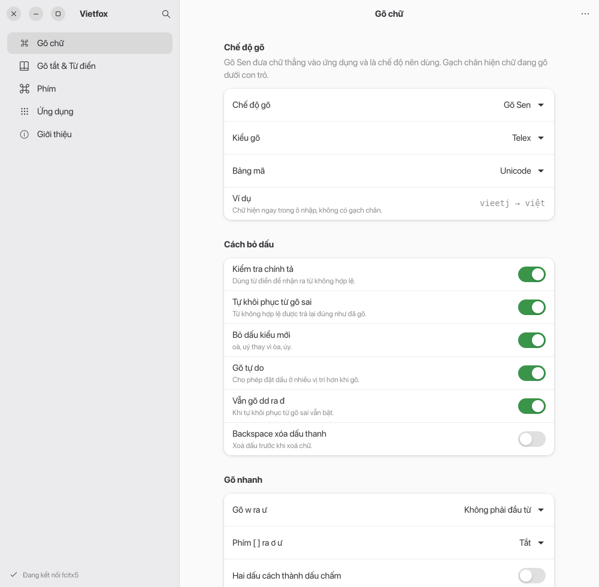
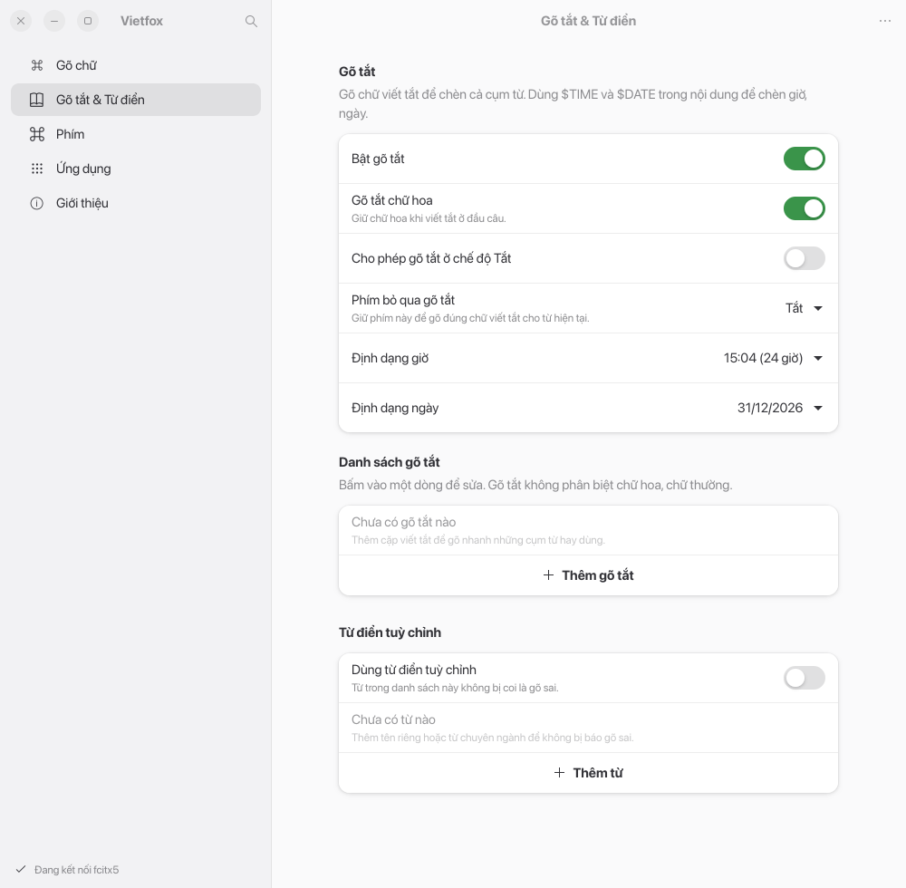
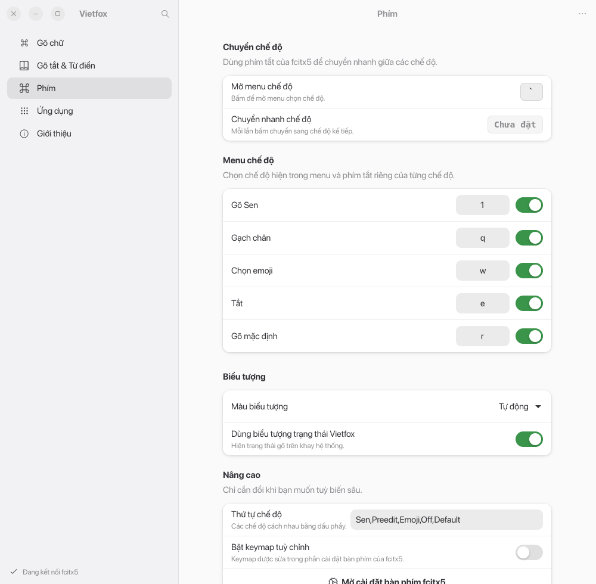
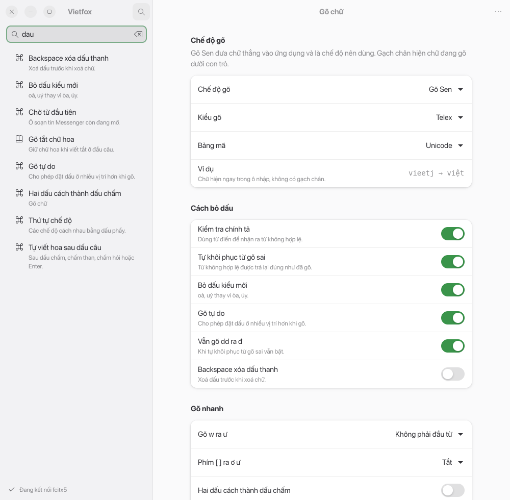
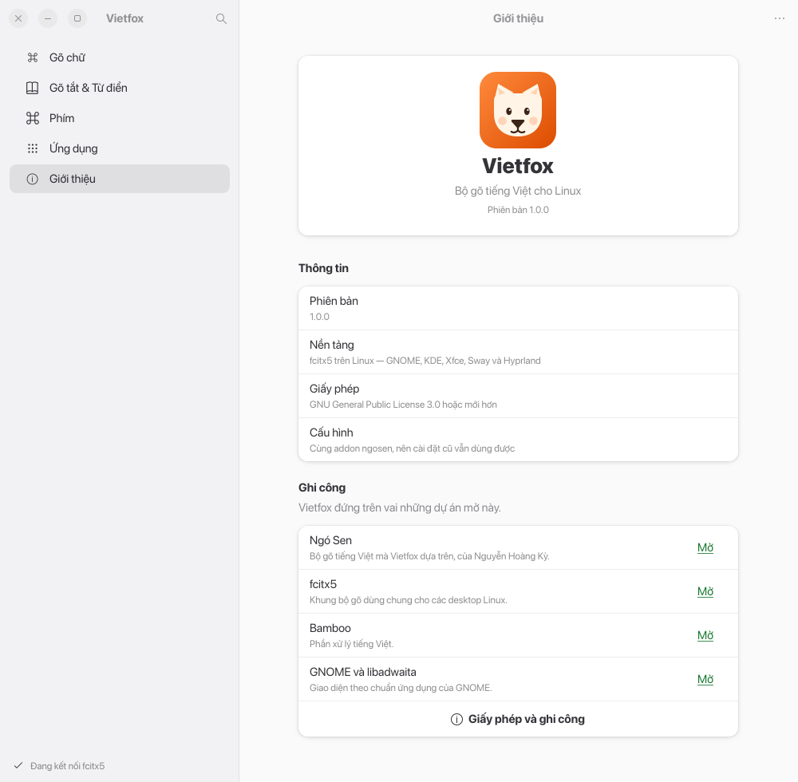

# Vietfox

Bộ gõ tiếng Việt cho Linux, giao diện viết lại hoàn toàn bằng **GTK 4 + libadwaita** — đúng kiểu cửa sổ
Settings của GNOME/Ubuntu: sidebar, nhóm cài đặt, công tắc, tìm kiếm, sáng/tối theo hệ thống.

Vietfox là bộ gõ tiếng Việt đóng gói trọn gói cho Linux: **giao diện GTK 4 + engine gõ đi kèm**.
Engine là addon fcitx5 `ngosen` lấy từ [Ngó Sen](https://github.com/ngosen/ngosen),
nên cài đặt, từ điển và quy tắc theo ứng dụng đang có vẫn dùng được. Cài bằng
`./install.sh --with-engine` là gõ được ngay, không cần cài thêm gói `fcitx5-ngosen`.
Phần giao diện cũ bằng Qt/PyQt không còn trong bản này.

<picture>
  <source media="(prefers-color-scheme: dark)" srcset="docs/screenshots/settings-dark.png">
  
</picture>

## Có gì trong cửa sổ

| Trang | Nội dung |
| --- | --- |
| **Gõ chữ** | Chế độ gõ, kiểu gõ, bảng mã, cách bỏ dấu, gõ nhanh, tuỳ chọn xử lý surrounding text |
| **Gõ tắt & Từ điển** | Bật gõ tắt, chữ hoa, định dạng `$TIME`/`$DATE`, danh sách gõ tắt, từ điển riêng |
| **Phím** | Phím mở menu chế độ, phím chuyển nhanh, phím tắt và hiển thị từng chế độ, màu biểu tượng |
| **Ứng dụng** | Quy tắc chế độ gõ riêng cho từng app (Zalo, Telegram, VS Code…) |
| **Giới thiệu** | Phiên bản, giấy phép, ghi công |

- Sửa là lưu ngay; không có nút OK/Apply. Mỗi lần lưu có toast kèm **Hoàn tác**.
- Tìm cài đặt bằng Ctrl+F hoặc nút kính lúp; tìm không dấu (`dau` khớp `dấu`).
- Menu chính: sao lưu/khôi phục cấu hình ra JSON, đặt lại về mặc định.
- Sáng/tối, cỡ chữ và màu nhấn theo hệ thống (libadwaita).
- Kết nối fcitx5 qua D-Bus (`org.fcitx.Fcitx.Controller1`); không có fcitx5 thì lưu tạm và báo rõ.

| Gõ tắt & Từ điển | Phím |
| --- | --- |
|  |  |

| Tìm cài đặt | Giới thiệu |
| --- | --- |
|  |  |

## Chạy thử

Cần Python 3.10+, PyGObject, GTK 4.14+ và libadwaita 1.6+ (Ubuntu 24.10 trở lên, Fedora 41+):

```
sudo apt install python3-gi gir1.2-gtk-4.0 gir1.2-adw-1    # Ubuntu / Debian
sudo dnf install python3-gobject gtk4 libadwaita           # Fedora
sudo pacman -S python-gobject gtk4 libadwaita              # Arch
```

Từ thư mục này:

```
./run.sh
```

hoặc `python3 -m vietfox`.

## Cài đặt

### Cách 1 — một bộ cài duy nhất (khuyến nghị)

```
./install.sh --with-engine
```

Lệnh này cài **giao diện + engine Ngó Sen đi kèm** vào máy, thêm “Vietfox” vào
nhóm gõ của fcitx5 rồi khởi động lại fcitx5. Sau đó **không cần** cài gói
`fcitx5-ngosen` nữa.

Installer cũng nối mục **Settings** trong menu Vietfox trên top bar tới giao diện Vietfox bằng
launcher `/usr/bin/fcitx5-ngosen-settings`. Nếu đã có launcher cùng tên của Ngó Sen, installer
giữ nguyên launcher đó để không ghi đè ứng dụng khác.

Trên Ubuntu với GNOME 50, Vietfox cài extension `forward-keys@ngosen.github.io` để sửa lỗi GNOME làm rơi phím được bộ gõ chuyển tiếp, khiến Chrome không nhận chữ tiếng Việt. Sau khi cài, hãy đăng xuất rồi đăng nhập lại để GNOME nạp extension; sau đó chạy một lần:

```sh
gnome-extensions enable forward-keys@ngosen.github.io
```

- Engine nằm trong `engine/` của repo (xem `engine/README.md`), giấy phép
  GPL-3.0-or-later, nguồn https://github.com/ngosen/ngosen.
- Cần `fcitx5` chạy trên máy; engine được cài vào `/usr` nên sẽ hỏi mật khẩu sudo.
- Nếu máy đã có gói `fcitx5-ngosen`, installer dùng engine hệ thống và bỏ qua
  bản đi kèm. Dùng `--force-engine` nếu muốn ghi đè.

### Cách 2 — chỉ cài giao diện

```
./install.sh              # cài cho người dùng hiện tại vào ~/.local; nối menu Settings nếu có engine
sudo ./install.sh --system  # cài vào /usr/local
./install.sh --uninstall    # gỡ bản cài cho người dùng
```

Trường hợp này máy phải có sẵn engine Ngó Sen:

```
curl -fsSL https://raw.githubusercontent.com/ngosen/ngosen/main/install.sh | bash
```

Cài xong chạy `vietfox` hoặc mở **Vietfox** trong menu ứng dụng, chọn chế độ
**Mặc định**, kiểu **Telex**, rồi dùng Ctrl+Space để bật bộ gõ.

## Gỡ

```
./install.sh --uninstall                 # gỡ giao diện, giữ engine
./install.sh --uninstall --with-engine   # gỡ cả engine (nếu không do gói hệ thống cung cấp)
```


## Cấu hình nằm ở đâu

Vietfox dùng đúng addon và đường dẫn của Ngó Sen, không tạo bản sao:

- addon fcitx5: `fcitx://config/addon/ngosen`
- gõ tắt: `~/.config/fcitx5/conf/ngosen-macro-table.conf`
- quy tắc app: `~/.config/fcitx5/conf/ngosen-app-rules.conf`
- từ điển riêng: `~/.local/share/fcitx5/ngosen/vietnamese.cm.dict`
- khi fcitx5 không chạy: `~/.config/vietfox/state.json`

Vì vậy nếu đã dùng Ngó Sen, mở Vietfox là thấy nguyên cài đặt cũ.

## Phát triển

```
vietfox/
├── application.py        # Adw.Application
├── version.py
├── core/
│   ├── backend.py        # D-Bus fcitx5 + lưu tạm khi offline
│   └── store.py          # kiểu dữ liệu, mặc định, lưu/hoàn tác
├── ui/
│   ├── window.py         # NavigationSplitView, sidebar, tìm kiếm, toast, menu
│   ├── dialogs.py        # ghi phím tắt, form thêm gõ tắt/từ/app
│   ├── helpers.py        # tìm không dấu, hiển thị phím tắt
│   └── pages/            # 5 trang cài đặt
└── data/                 # icon và desktop entry
```

Thêm một cài đặt mới: khai báo trong trang tương ứng bằng `self.switch`, `self.combo`, `self.spin`,
`self.entry` hoặc `self.hotkey` (xem `ui/pages/base.py`). Mặc định và kiểu dữ liệu được đăng ký luôn,
nên nút đặt lại và bản sao lưu tự biết giá trị đó.

Chạy kiểm tra:

```
python3 -m unittest discover -s tests -v
```

## Ghi công

- [Ngó Sen](https://github.com/ngosen/ngosen) của Nguyễn Hoàng Kỳ — engine và toàn bộ phần xử lý tiếng Việt.
- [fcitx5](https://fcitx-im.org) — khung bộ gõ.
- [Bamboo](https://github.com/BambooEngine/ibus-bamboo) — phần lõi tiếng Việt.
- GNOME / libadwaita — bộ widget dùng trong giao diện.

## Giấy phép

GPL-3.0-or-later. Xem [LICENSE](LICENSE).
